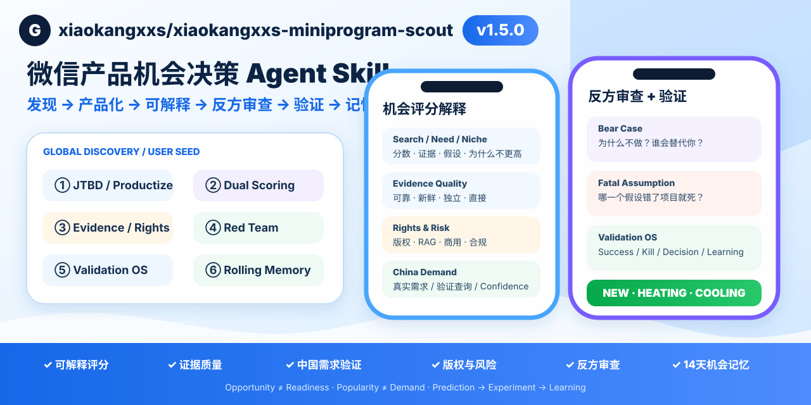
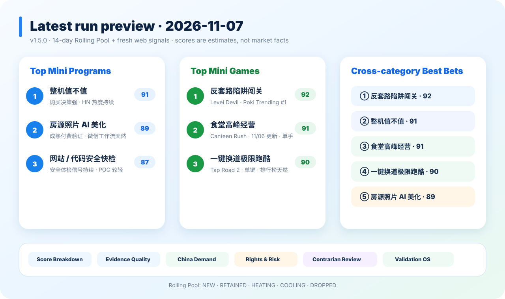
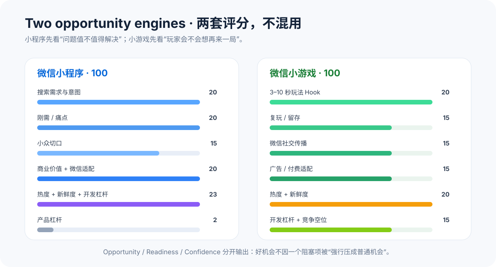

<sub>🌐 <a href="README.md">中文</a> · <b>English</b></sub>

<div align="center">

# xiaokangxxs-miniprogram-scout

> **Global signals or your own idea / repositories / feedback → WeChat opportunity intelligence**

[](VERSION)
[](LICENSE)
[](SKILL.md)
[](README.md)

**Find opportunities worth building — not just products that launched today.**

```bash
npx skills add xiaokangxxs/xiaokangxxs-miniprogram-scout
```

[Quick Start](#quick-start) · [What it does](#what-it-does) · [Scoring](#two-separate-opportunity-engines) · [Sources](#data-sources) · [Security](SECURITY.md)

</div>

<p align="center">
  
</p>

---

## Output preview

<p align="center">
  
</p>

See the full dated run: [docs/LATEST_RUN.md](docs/LATEST_RUN.md).

---

## What is this?

`xiaokangxxs-miniprogram-scout` is an agent-agnostic Skill for product discovery and China localization.

It continuously asks:

> **Which global product or game signals are worth turning into a WeChat Mini Program or Mini Game — and why now?**

It does **not** blindly translate Product Hunt launches. It combines multi-source discovery, rolling candidate pools, evidence grading, platform routing, opportunity scoring, WeChat readiness checks and Mini PRD conversion.

## What it does

| Capability | Output |
|---|---|
| Global product discovery | Product Hunt, HN, GitHub, Neeed, BetaList, Indie Hackers, optional Reddit/G2 |
| Game mechanic discovery | itch.io, Poki, Steam, CrazyGames, game jams/prototypes |
| Product-form routing | Mini Program / Mini Game / Web / App / Desktop / Reject |
| Mini Program scoring | Search intent, rigid need, niche wedge, monetization, WeChat fit, heat, freshness, buildability |
| Mini Game scoring | 3–10s hook, replayability, social loop, monetization, heat, freshness, buildability |
| Rolling opportunity pool | 14-day pool + champion board, so good ideas do not disappear tomorrow |
| WeChat readiness | Category, qualification, privacy, payment, notifications, ads, game publication, performance |
| Requirement conversion | Top 10 boards + Top 3 Mini PRDs + Cross-category Best Bets |

## v1.5 · Trust, Validate & Remember

v1.5 adds an auditable decision layer after discovery/productization:

- Score Explainability
- Evidence Quality Matrix
- China Demand Validator
- Rights & Risk Gate
- Contrarian Reviewer
- Validation OS
- Persistent 14-day Rolling Pool / Champion history

```text
Score
→ Explain
→ Audit evidence
→ Validate China demand
→ Rights/Risk
→ Red Team
→ Experiment
→ Learn / Remember
```

The Mini Program and Mini Game scoring weights remain unchanged.

---

## v1.4 · From discovery to productization

The Skill can now start from **your own seed material**, not only public discovery sources.

```text
idea / requirement / GitHub repos / competitor links / feedback / files
→ User Seed
→ JTBD Extraction
→ Product Reframe
→ 3–5 Concepts
→ Product Form Router
→ Mini Program / Mini Game scoring
→ P0 + validation + Kill Criteria
```

The model is explicitly allowed to say:

> The underlying problem is worth solving, but your current product definition is weak.

New references:

- [User Seed Mode](references/user_seed_mode.md)
- [JTBD Extraction](references/jtbd_extraction.md)
- [Product Reframe](references/product_reframe.md)
- [Multi-Concept Generation](references/multi_concept_generation.md)

---

## WorkBuddy expert team

The repository now includes a **WorkBuddy multi-agent expert-team edition** in [`workbuddy/`](workbuddy/README.md).

It uses one lead plus six specialists:

- Atlas — team lead / final ranking
- Nova — global product discovery
- Pixel — game-mechanic discovery
- Mira — China demand analysis
- Mini — WeChat Mini Program strategy
- Arc — WeChat Mini Game design
- Gate — WeChat readiness & evidence audit

Build a WorkBuddy-ready ZIP:

```bash
npm run sync:workbuddy
npm run validate:workbuddy
npm run build:workbuddy
```

Output: `dist/wechat-opportunity-scout-team-workbuddy.zip`.

The WorkBuddy team shares the same Scout Skill; repository validation checks for drift between the root Skill and the embedded WorkBuddy copy.

## Quick start

### Install with Skills CLI

```bash
npx skills add xiaokangxxs/xiaokangxxs-miniprogram-scout
```

Non-interactive:

```bash
npx skills add xiaokangxxs/xiaokangxxs-miniprogram-scout --yes
```

This repository itself is **not an npm package**. `npx` downloads the public `skills` CLI from npm; the CLI then installs this Skill directly from GitHub. No npm publish is required for this repository.

As of 2026-11-07, the current `skills` CLI requires Node.js 22.20+. The git-clone fallback below does not depend on the CLI. skills.sh indexing is not required for installation; the official ecosystem can discover repositories through anonymous CLI installation telemetry. Set `DISABLE_TELEMETRY=1` to opt out.

If your Agent/runtime does not support Skills CLI:

```bash
git clone https://github.com/xiaokangxxs/xiaokangxxs-miniprogram-scout.git
```

Or import `UNIVERSAL_SINGLE_FILE.md` as a system/project instruction.

### Run

```text
Use xiaokangxxs-miniprogram-scout.
Scan current global product and game signals, merge them with the 14-day rolling pool,
then give me:
1) Top 10 WeChat Mini Program opportunities
2) Top 10 WeChat Mini Game opportunities
3) Cross-category Top 5 Best Bets
Separate Observed / Proxy / Estimate / Unknown.
```

### Optional credentials

Prefer a secret store. For local runtimes:

```bash
cp .env.example .env
```

Supported variables:

- `PRODUCTHUNT_TOKEN` — official Product Hunt API mode
- `GITHUB_TOKEN` — optional higher GitHub API limits

No real credential is stored in this repository.

## Two separate opportunity engines

<p align="center">
  
</p>

Mini Programs and Mini Games are not scored with the same assumptions.

### Mini Program

Primary signals:

- active search intent
- rigid/high-value pain
- narrow niche
- monetizable value
- WeChat-native distribution

Secondary signals:

- trend momentum
- freshness
- solo-dev buildability

### Mini Game

Primary signals:

- instant hook
- replay loop
- WeChat social loop
- monetization fit

Secondary signals:

- heat
- novel mechanic
- asset/build leverage
- competition gap

## Evidence discipline

Every important claim must be one of:

- **Observed** — directly verified
- **Proxy** — indirect signal such as votes/stars/reviews
- **Estimate** — model judgment
- **Unknown** — not reliably verified

The Skill must never fabricate search volume, ASO metrics, revenue, downloads, retention, WeChat permissions or qualifications.

## Data sources

### Product / utility discovery

Product Hunt, Hacker News, Neeed, GitHub, BetaList, Indie Hackers, optional Reddit and G2.

### Mini Game discovery

itch.io, Poki, Steam, CrazyGames and public game-jam/prototype signals.

Source rules and fallbacks are documented in [references/source_registry.md](references/source_registry.md).

## WeChat policy awareness

Before a top idea is treated as launch-ready, the Skill checks current official constraints where relevant:

- service category / subject
- qualifications / filing
- privacy and consent
- payments / virtual goods
- subscription/service notifications
- game qualifications / publication
- ads / IAP
- package, engine and low-end device performance
- IP/content review

See [references/wechat_official_constraints.md](references/wechat_official_constraints.md).

## Repository self-check

The repository self-check scripts require Node.js 18+ and no dependencies. This is separate from the current Skills CLI requirement (Node.js 22.20+ as of 2026-11-07):

```bash
npm run check
```

It validates:

- required Skill files are present
- version metadata is consistent
- SKILL frontmatter exists
- key referenced files exist
- common secret/token patterns are not accidentally committed

## Documentation

- [Installation & Agent compatibility](docs/INSTALL.md)
- [WorkBuddy expert team](workbuddy/README.md)
- [Architecture](docs/ARCHITECTURE.md)
- [Latest real Scout run](docs/LATEST_RUN.md)
- [Example report](docs/EXAMPLE_REPORT.md)
- [FAQ](docs/FAQ.md)
- [Release checklist](docs/RELEASE_CHECKLIST.md)
- [Security & data flow](SECURITY.md)
- [Contributing](CONTRIBUTING.md)

## License & attribution

MIT License.

```text
Copyright (c) 2026 xiaokangxxs
```

When redistributing or deriving substantial work, keep the copyright and license notice. Attribution is also appreciated:

```text
Based on xiaokangxxs-miniprogram-scout by xiaokangxxs.
Source: github.com/xiaokangxxs/xiaokangxxs-miniprogram-scout
```

See [ATTRIBUTION.md](ATTRIBUTION.md) and [CITATION.cff](CITATION.cff).

---

This project is a research and product-decision tool. Scores are not guarantees of market success.
