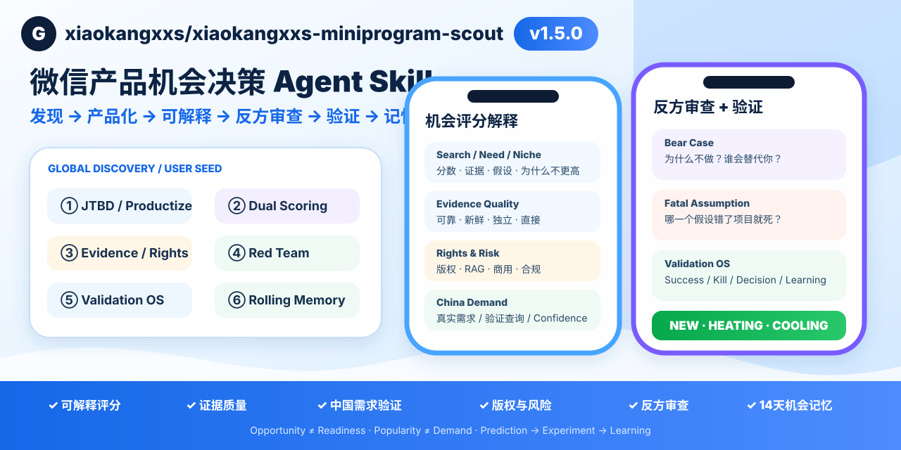
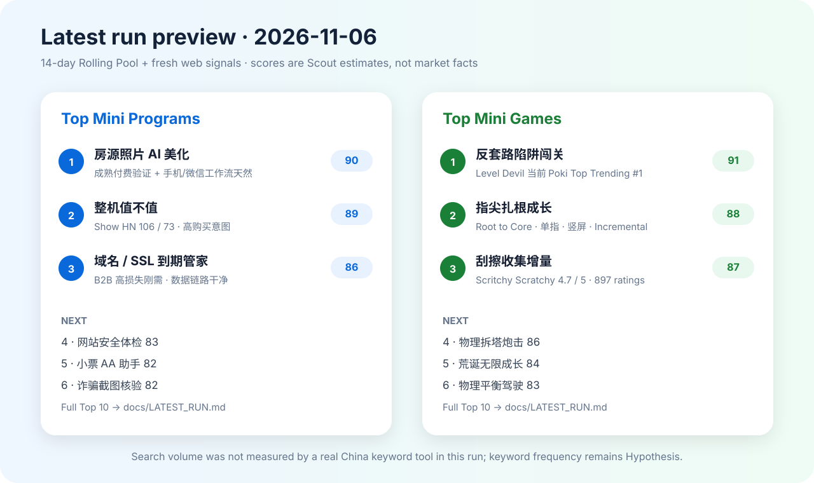
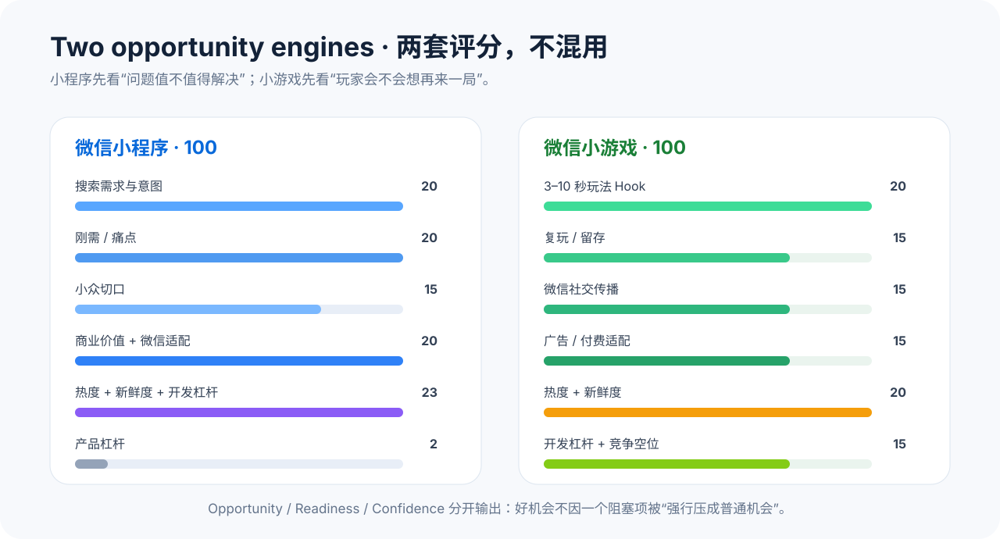

<sub>🌐 <b>中文</b> · <a href="README.en.md">English</a></sub>

<div align="center">

# xiaokangxxs-miniprogram-scout

> **发现或产品化微信机会，并让每个结论可解释、可反驳、可验证、可记忆。**

[](VERSION)
[](LICENSE)
[](docs/INSTALL.md)
[](SKILL.md)

<br>

**不是 Product Hunt 翻译器，也不是“看到热门产品就抄成小程序”。**

它既能主动找全球信号，也能直接吃你给的需求、GitHub、竞品和反馈；先提取 JTBD、必要时重构产品定义、生成多个方案，再路由产品形态、评分并检查微信限制。

<br>

```bash
npx skills add xiaokangxxs/xiaokangxxs-miniprogram-scout
```

支持完整 Skill 的 Agent 直接装仓库；不支持目录 Skill 的 Agent 可使用 `UNIVERSAL_SINGLE_FILE.md`。

[30 秒上手](#30-秒上手) · [它能做什么](#它能做什么) · [怎么判断机会](#两套独立机会模型) · [数据源](#数据源) · [安装](#安装) · [安全](SECURITY.md)

</div>

<p align="center">
  
</p>

---

## 效果预览

这不是一个“只讲规则”的 Skill。仓库会保留**脱敏示例**和**最新一次真实 Scout Run**，让你能直接看到它最后会产出什么。

<p align="center">
  
</p>

👉 [查看 2026-11-06 完整运行结果、Top 10 与 Top 3 需求转化](docs/LATEST_RUN.md)

> 最新运行结果是带日期的快照；第二天再次运行时，Fresh Pool 和热度信号可能变化，但 14 天 Rolling Pool 不会被清空。

---

## 先看一句话

你说：

```text
用 xiaokangxxs-miniprogram-scout 跑今天的全球新品和游戏机制，
结合最近 14 天候选池，给我：
1. Top 10 微信小程序机会
2. Top 10 微信小游戏机会
3. Cross-category Top 5 Best Bets
重点看：值得做、刚需/强乐趣、小众、最新、最火、最好开发。
```

Skill 应该给你的不是“今天有什么新品”，而是：

> **现在什么值得做、为什么值得做、为什么适合微信、最快怎么验证、最大的阻塞是什么。**

---

## 为什么做这个 Skill

海外每天都会出现大量新产品、新工具、新游戏和新玩法。

问题从来不是：

> “哪里还能看到更多榜单？”

而是：

> **“这些东西里，哪一个值得我在中国重新做？应该做成微信小程序、微信小游戏，还是根本不该做？”**

单看某一个榜单很容易误判：

- Product Hunt #1 可能只是开发者基础设施；
- GitHub Stars 不等于用户愿意付钱；
- 一个海外 SaaS 能成立，不代表微信小程序是正确形态；
- “今天很火”可能只有一天；
- “很好开发”可能只是一个没人专门搜索的小功能；
- 一个小游戏搜索量不高，不代表它不是好游戏；
- 微信能写出来，不等于类目、资质、隐私、支付、广告或审核能过。

所以这个 Skill 把这些问题拆开处理。

---

## 它能做什么

| 能力 | 交付 |
|---|---|
| 全球新品发现 | Product Hunt、HN、GitHub、Neeed、BetaList、Indie Hackers 等 |
| User Seed Mode | 直接接收需求描述、GitHub、竞品、用户反馈、文件/导出数据 |
| JTBD Extraction | 从“想做什么”还原成“谁在什么场景下真正要解决什么问题” |
| Product Reframe | 对原始想法给 KEEP / REFRAME / SPLIT / REJECT，不盲从产品定义 |
| Multi-concept Generation | 同一组素材生成 3–5 个真正不同的产品概念，再分别路由和评分 |
| 小游戏机制发现 | itch.io、Poki、Steam、CrazyGames、Game Jam / Browser Prototype |
| 14 天滚动候选池 | 新品挑战旧冠军，不会每天把榜单清零 |
| Product Form Router | 自动判断小程序 / 小游戏 / Web / App / Desktop / Reject |
| 微信小程序机会评分 | 搜索、刚需、小众、商业价值、微信适配、热度、新鲜度、开发杠杆 |
| 微信小游戏机会评分 | 3–10 秒 Hook、复玩、社交、变现、热度、新玩法、开发成本 |
| Evidence First | Observed / Proxy / Estimate / Unknown |
| 微信可上线性检查 | 类目、资质、备案、隐私、支付、通知、广告、游戏规则、性能、IP |
| 需求转化 | Top 10 榜单 + Top 3 Mini PRD + Best Bets |
| 快速验证设计 | 第一批 1000 用户、Time-to-Signal、Kill Criteria |

---

## v1.5 · Trust, Validate & Remember

v1.4 解决“**到底应该做什么产品**”。

v1.5 继续解决：

> **为什么相信这个分数？最可能错在哪里？版权/中国需求是否成立？验证以后能不能留下真实学习？**

新增 7 项能力：

| 能力 | 作用 |
|---|---|
| Score Explainability | 每项分数都给证据、假设、为什么不更高、Gate/Cap |
| Evidence Quality Matrix | 评估可靠性、新鲜度、独立性、相关性、直接性 |
| China Demand Validator | 从 Search Hypothesis 进入可执行的中国需求验证 |
| Rights & Risk Gate | License、商用、转载、RAG/Embedding、健康/金融/法律等 |
| Contrarian Reviewer | Bear Case、替代风险、Fatal Assumption、Red Team |
| Validation OS | Hypothesis → Experiment → Result → Decision → Learning |
| Real Rolling Pool | 真实持久化 Fresh / 14-day Rolling / Top20 Champion + 历史变化 |

决策链路现在是：

```text
发现 / User Seed
      ↓
JTBD / Reframe / Concepts
      ↓
双评分引擎
      ↓
Score Explainability
      ↓
Evidence Quality
      ↓
China Demand + Rights & Risk
      ↓
Contrarian Reviewer
      ↓
Final Verdict
      ↓
Validation OS
      ↓
Rolling Memory / Learning
```

评分权重**没有改变**，避免破坏历史可比性。

---

## v1.4 · 从“机会侦察”升级到“产品化判断”

除了“今天有什么值得做”，现在也可以直接把你的原始需求丢给 Skill。

例如：

```text
我有 7 个 GitHub 开源项目，都是生活/健康/做饭/投资/关系/成长指南。
我想把它们做成一个指南集合小程序，帮我判断。
```

v1.4 不会直接顺着“指南集合”往下画功能，而会先跑：

```text
用户素材
  ↓
User Seed Mode
  ↓
JTBD Extraction
  ↓
Product Reframe
  ├─ KEEP
  ├─ REFRAME
  ├─ SPLIT
  └─ REJECT
  ↓
生成 3–5 个真正不同的 Product Concepts
  ↓
Product Form Router
  ↓
小程序 / 小游戏双引擎评分
  ↓
推荐一个最值得验证的方向
```

默认会告诉你：

- 原始产品定义哪里对、哪里弱；
- 用户真正的触发场景和 JTBD；
- 3–5 个不同产品方案，而不是换名字；
- 每个方案更适合小程序、小游戏、Web、App 还是 Reject；
- 最强方案的 Opportunity / Readiness / Confidence；
- P0、最快验证和 Kill Criteria。

详细规则：

- [User Seed Mode](references/user_seed_mode.md)
- [JTBD Extraction](references/jtbd_extraction.md)
- [Product Reframe](references/product_reframe.md)
- [Multi-Concept Generation](references/multi_concept_generation.md)

---

## WorkBuddy 专家团

除了单 Skill 形态，仓库现在还提供一套 **WorkBuddy 多 Agent 专家团**：

👉 [进入 workbuddy/ 专家团目录](workbuddy/README.md)

专家团不是 7 个重复人设，而是把完整流程拆成：

```text
凌策 / Atlas        团长：调度、冲突裁决、最终榜单
闻新 / Nova         全球新品侦察
弈野 / Pixel        游戏机制侦察
知需 / Mira         中国需求分析
程策 / Mini         微信小程序策略
游策 / Arc          微信小游戏玩法设计
守界 / Gate         微信合规与证据审计
```

默认全量流程：

```text
产品发现 ─┐
          ├→ 中国需求 → 小程序/小游戏双引擎 → 合规审计 → 团长裁决
玩法发现 ─┘
```

构建可上传 WorkBuddy 的 ZIP：

```bash
npm run sync:workbuddy
npm run validate:workbuddy
npm run build:workbuddy
```

输出：`dist/wechat-opportunity-scout-team-workbuddy.zip`。

WorkBuddy 专家团共享根目录同一套 Scout Skill；CI 会检查专家团副本是否与主 Skill 漂移。

---

## 30 秒上手

### 1. 安装

推荐用官方 open agent skills CLI：

```bash
npx skills add xiaokangxxs/xiaokangxxs-miniprogram-scout
```

自动化/不想交互选择时：

```bash
npx skills add xiaokangxxs/xiaokangxxs-miniprogram-scout --yes
```

**这里不是把本仓库发布到 npm。**

实际链路是：

```text
npx
  ↓ 从 npm 临时获取 skills CLI
skills CLI
  ↓ 直接读取 GitHub owner/repo
xiaokangxxs/xiaokangxxs-miniprogram-scout
  ↓ 安装 SKILL.md + references/assets/docs...
你的 Agent
```

所以你的 Skill **无需发布成 npm package，也能通过 npx 安装**。截至 2026-11-06，官方 `skills` CLI 当前要求 Node.js 22.20+；Node 较旧时直接用下面的 git clone fallback 即可。

> skills.sh 榜单不是安装前提。官方说明是：用户通过 `npx skills add owner/repo` 安装后，匿名安装遥测会用于自动发现/排行。若不希望 CLI 发送匿名安装遥测，可设置 `DISABLE_TELEMETRY=1`。

如果当前 Agent 不支持 Skills CLI：

```bash
git clone https://github.com/xiaokangxxs/xiaokangxxs-miniprogram-scout.git
```

或者直接导入：

```text
UNIVERSAL_SINGLE_FILE.md
```

详细兼容方式见 [docs/INSTALL.md](docs/INSTALL.md)。

### 2. 可选：配置凭证

优先使用 Agent 自带 Secret Store。

本地环境可以：

```bash
cp .env.example .env
```

支持：

```text
PRODUCTHUNT_TOKEN
GITHUB_TOKEN
```

Product Hunt 没 Token、但 Agent 可以正常浏览网页时，允许用有限的 Public Web fallback；必须明确标记，不能假装是官方 API 完整结果。

### 3. 运行

```text
帮我跑今天的数据。
小程序和小游戏分开评估，
再从两个榜里挑 5 个最值得先实验的方向。
```

---

## 两套独立机会模型

<p align="center">
  
</p>

### 微信小程序

小程序首先是**任务/服务型产品**。

100 分模型：

| 维度 | 权重 |
|---|---:|
| 搜索需求与意图 | 20 |
| 刚需 / 痛点 | 20 |
| 小众切口 | 15 |
| 商业价值 / 付费 | 10 |
| 微信原生适配 | 10 |
| 热度 / Momentum | 8 |
| 最新 / 新鲜度 | 5 |
| 最好开发 / Buildability | 10 |
| 产品杠杆 | 2 |

核心偏好：

> **值得做 + 会主动搜索 + 刚需 + 小众 + 有热度 + 足够新 + 小团队能快速验证。**

### 微信小游戏

小游戏首先是**玩、挑战、竞争、重复体验**。

100 分模型：

| 维度 | 权重 |
|---|---:|
| 3–10 秒玩法钩子 | 20 |
| 复玩 / 留存循环 | 15 |
| 微信社交传播 | 15 |
| 广告 / 付费适配 | 15 |
| 热度 / Momentum | 10 |
| 最新 / 新玩法 | 10 |
| 开发 / 素材杠杆 | 10 |
| 竞争空位 | 5 |

核心问题：

> **3 秒能不能懂？玩完会不会再来一局？能不能自然分享/排行？变现会不会毁掉体验？**

小程序和小游戏**不能用一套评分模型**。

---

## Product Form Router

每个候选先判断应该是什么：

```text
全球产品 / 游戏 / 用户问题
          │
          ▼
  Product Form Router
          │
 ┌────────┼────────┬──────────┐
 ▼        ▼        ▼          ▼
小程序    小游戏   Web/App    Reject
```

如果微信没有明显的渠道、交互或场景优势，就不强行“微信化”。

详细规则见 [references/platform_router.md](references/platform_router.md)。

---

## 最新、最火、最好开发都怎么算

### 最新 Freshness

不是只看发布时间：

- 产品发布日期；
- 玩法/行为新鲜度；
- 中国市场新鲜度；
- 微信生态新鲜度。

一个国外三年前成立的模式，如果在微信生态仍然存在明显空位，仍可能是新机会。

### 最火 Trend Momentum

不迷信单点榜单：

- 排名变化；
- 评论/评价/Stars/玩家增长；
- 多源同时出现；
- 同一需求/机制突然出现多款产品；
- 热度能否持续。

热度是 **Proxy**，不是收入。

### 最好开发 Buildability

看：

- 1–3 天能否做 POC；
- 个人开发者还是团队；
- 2D / 轻 3D / 重 3D；
- 素材量；
- 后端复杂度；
- 数据/API 依赖；
- AI 成本；
- UGC 审核；
- 长期运营 / LiveOps。

**容易做只能提高验证效率，不能拯救弱需求。**

---

## 真实 14 天 Rolling Pool：不是“今日新品榜”

默认维护两套候选池：

```text
24–72h Fresh Pool
        ↓
14-day Rolling Pool
        ↓
Champion Board
        ↓
今天新品挑战旧冠军
        ↓
当前真正最强 Top 10
```

分别维护：

- Mini Program Champion Board
- Mini Game Champion Board

v1.5 开始，状态真实持久化在：

`data/rolling_pool.json`

并由 `scripts/rolling-pool.mjs` 校验/合并。只允许保存公开市场信号，禁止写入用户私有需求、文件、Token、Cookie 或凭据。

所以昨天真正优秀的“房源 AI 修图”不会因为今天来了 30 个 Agent 产品就自动消失。

同一赛道多个产品会聚合成一个机会主题，避免 Top 10 被同类产品刷屏。

---

## Trust the Score

### Score Explainability

Top 3 / 推荐概念会拆解每个评分组件：

- 得分 / 满分
- Evidence
- Assumption
- Why not higher
- Hard Gate / Cap

不允许隐藏 bonus。

### Contrarian Review

最终推荐必须回答：

- 为什么不做？
- 为什么用户直接用通用 AI / 巨头 / 手工方案？
- 第一批用户为什么可能来不了？
- 哪个假设错了整个项目最可能死亡？

并给出 Fatal Assumption 的最快证伪实验。

### Rights & Risk

GitHub 公开 ≠ 可以商用/RAG。

会检查 License、转载、修改、商用、RAG/Embedding、署名、授权，以及健康/金融/法律/隐私等风险。

---

## Evidence First

所有重要结论必须属于以下一种：

| 类型 | 含义 |
|---|---|
| **Observed** | 官方 API / 官网 / 定价页直接看到 |
| **Proxy** | votes、stars、comments、reviews、rank 等间接信号 |
| **Estimate** | 基于证据做的产品判断 |
| **Unknown** | 没有可靠数据 |

禁止：

```text
Product Hunt 300 votes = 月收入 3 万
GitHub 5000 stars = 5000 付费用户
100 reviews = 100 个活跃客户
```

没有真实关键词工具时：

```text
ASO真实数据：未验证
Search Frequency：Hypothesis
```

不能编造 Popularity、Difficulty、微信指数、搜索量。

---

## 微信官方限制不是“最后提醒”

一个产品市场机会很高，不代表现在就能上线。

Skill 会把：

> **值不值得做**

和：

> **现在能不能在微信上线**

分开。

重点检查：

### 小程序

- 主体；
- 服务类目；
- 类目资质；
- 备案；
- 隐私与授权；
- 支付 / 虚拟内容；
- 订阅/服务通知；
- 实际功能是否和申报类目一致。

### 小游戏

额外看：

- 游戏类目；
- 游戏相关资格 / 备案 / 出版要求；
- 广告资格；
- 虚拟支付；
- IP / 内容审核；
- 包体、分包、远程资源；
- 引擎与低端机性能；
- 社交分享规则。

微信规则会变化，因此易过期的限制**不写死**；正式 BUILD / LAUNCH 前，以当前微信官方文档和公众平台后台为准。

详见 [references/wechat_official_constraints.md](references/wechat_official_constraints.md)。

---

## 数据源

### 产品 / 小程序机会

- Product Hunt
- Hacker News / Show HN / Ask HN
- Neeed
- GitHub
- BetaList
- Indie Hackers
- optional Reddit / G2

### 游戏 / 小游戏机会

- itch.io New & Popular
- Poki
- Steam
- CrazyGames
- Game Jam / Browser Prototypes

完整来源、凭证、fallback 和证据规则见 [references/source_registry.md](references/source_registry.md)。

---

## 默认交付

一次标准运行输出：

### Top 10 微信小程序机会

包含：

- 核心搜索词；
- 刚需理由；
- 小众人群；
- 最新 / 热度 / 开发成本；
- Opportunity / Readiness / Confidence；
- 第一批 1000 用户假设；
- 微信官方阻塞项；
- 最快验证方式。

### Top 10 微信小游戏机会

包含：

- 核心机制；
- 3–10 秒 Hook；
- 复玩循环；
- 微信社交循环；
- IAA / IAP / Hybrid；
- 最新 / 热度 / 开发成本；
- Prototype 计划；
- 游戏官方规则阻塞项。

### v1.5 额外交付

Top 3 / 最终推荐额外包含：

- 完整 Score Breakdown；
- Evidence Quality；
- China Demand Confidence / 验证查询；
- Rights & Risk；
- Bear Case / Fatal Assumption；
- Validation OS 实验；
- 日报 NEW / RETAINED / HEATING / COOLING / DROPPED。

### Cross-category Top 5 Best Bets

回答：

> **如果现在只能做 5 个实验，优先做什么？**

---

## 示例

仓库自带一份脱敏示例报告：

👉 [docs/EXAMPLE_REPORT.md](docs/EXAMPLE_REPORT.md)

它用于展示结构，不代表当天实时榜单。

最新一轮真实运行快照：

👉 [docs/LATEST_RUN.md](docs/LATEST_RUN.md)

你也可以直接运行：

```text
用这个 Skill 分析这个海外产品是否适合中国微信生态：<URL>
```

或者：

```text
读取我给你的 CSV / JSON / HTML 产品榜单，
跳过抓取，从机会聚类和评分开始。
```

---

## 安装后先自检

这个仓库不是只有一个 `SKILL.md`。

完整运行依赖：

```text
references/
assets/
docs/
evals/
scripts/
```

如果你 clone 了仓库或准备二次发布，建议运行：

```bash
npm run check
```

不需要安装 npm 依赖。

它会检查：

- 核心文件是否完整；
- 版本号是否一致；
- SKILL frontmatter；
- 关键引用文件是否存在；
- 常见 Token / Secret 是否误提交。

也可以单独执行：

```bash
npm run validate
npm run validate:pool
npm run scan:secrets
```

---

## 仓库结构

```text
xiaokangxxs-miniprogram-scout/
├── SKILL.md
├── UNIVERSAL_SINGLE_FILE.md
├── README.md
├── README.en.md
├── VERSION
├── package.json
├── .env.example
├── LICENSE
├── ATTRIBUTION.md
├── CITATION.cff
├── SECURITY.md
├── CONTRIBUTING.md
├── CHANGELOG.md
├── test-prompts.json
├── references/
│   ├── master_prompt_v3_6.md
│   ├── user_seed_mode.md
│   ├── jtbd_extraction.md
│   ├── product_reframe.md
│   ├── multi_concept_generation.md
│   ├── platform_router.md
│   ├── scoring_model.md
│   ├── score_explainability.md
│   ├── evidence_quality_matrix.md
│   ├── china_demand_validator.md
│   ├── rights_and_risk_gate.md
│   ├── contrarian_reviewer.md
│   ├── validation_os.md
│   ├── rolling_candidate_pool.md
│   ├── source_registry.md
│   ├── evidence_rules.md
│   ├── china_feasibility_gate.md
│   ├── wechat_official_constraints.md
│   └── output_schema.md
├── assets/
├── data/
│   ├── rolling_pool.json
│   └── rolling_pool.schema.json
├── docs/
├── evals/
├── scripts/
├── workbuddy/              # WorkBuddy 专家团源码与共享 Skill
└── .github/
```

架构说明见 [docs/ARCHITECTURE.md](docs/ARCHITECTURE.md)。

---

## Star 趋势

<p align="center">
  <a href="https://star-history.com/#xiaokangxxs/xiaokangxxs-miniprogram-scout&Date">
    
  </a>
</p>

---

## 文档入口

- 📦 [安装与 Agent 兼容](docs/INSTALL.md)
- 👥 [WorkBuddy 专家团](workbuddy/README.md)
- 🧠 [架构与工作流](docs/ARCHITECTURE.md)
- 🖼️ [v1.5 Social Preview 源图](assets/readme/social-preview-v1.5.svg)
- 📊 [最新 Scout Run](docs/LATEST_RUN.md)
- 🧪 [脱敏示例报告](docs/EXAMPLE_REPORT.md)
- ❓ [FAQ](docs/FAQ.md)
- 🚢 [Release Checklist](docs/RELEASE_CHECKLIST.md)
- 🔐 [Security & Data Flow](SECURITY.md)
- 🤝 [Contributing](CONTRIBUTING.md)

---

## 安全

这个仓库**没有自己的云后端、没有遥测、没有作者控制的数据采集服务器**。

Skill 本身主要是 Markdown 规则；真正的网络请求由你正在使用的 Agent / Browser / HTTP / Connector 工具执行。

仓库里的本地脚本：

```text
scripts/validate-skill.mjs
scripts/validate-workbuddy-team.mjs
scripts/generate-workbuddy-avatars.mjs
scripts/build-workbuddy-package.mjs
scripts/rolling-pool.mjs
scripts/secret-scan.mjs
```

只读取本地仓库文件，不联网。

详细网络目的地、凭证边界和数据流见 [SECURITY.md](SECURITY.md)。

---

## Contributing

欢迎贡献：

- 新产品/游戏数据源；
- 更可靠的中国需求/关键词验证；
- 微信官方规则更新；
- 新的评分纠错案例；
- Agent 兼容适配；
- Mini Program / Mini Game evals。

提交 PR 前：

```bash
npm run check
```

详见 [CONTRIBUTING.md](CONTRIBUTING.md)。

---

## License & Attribution

MIT License。

```text
Copyright (c) 2026 xiaokangxxs
```

你可以自由使用、修改、分发和商用。复制或分发本项目或其重要部分时，需要保留 MIT License 要求的版权与许可证声明。

二次开发 / 公开分享时也推荐注明：

```text
Based on xiaokangxxs-miniprogram-scout by xiaokangxxs.
Source: github.com/xiaokangxxs/xiaokangxxs-miniprogram-scout
```

详见 [ATTRIBUTION.md](ATTRIBUTION.md) 和 [CITATION.cff](CITATION.cff)。

---

## Disclaimer

这个 Skill 是产品研究与机会决策工具。

**热度不是收入，评分不是市场事实，Search Hypothesis 不是搜索量事实，BUILD NOW 也不是微信审核保证。**

正式投入开发前仍应完成真实用户、关键词、数据/API、微信官方规则、合规与付费验证。
