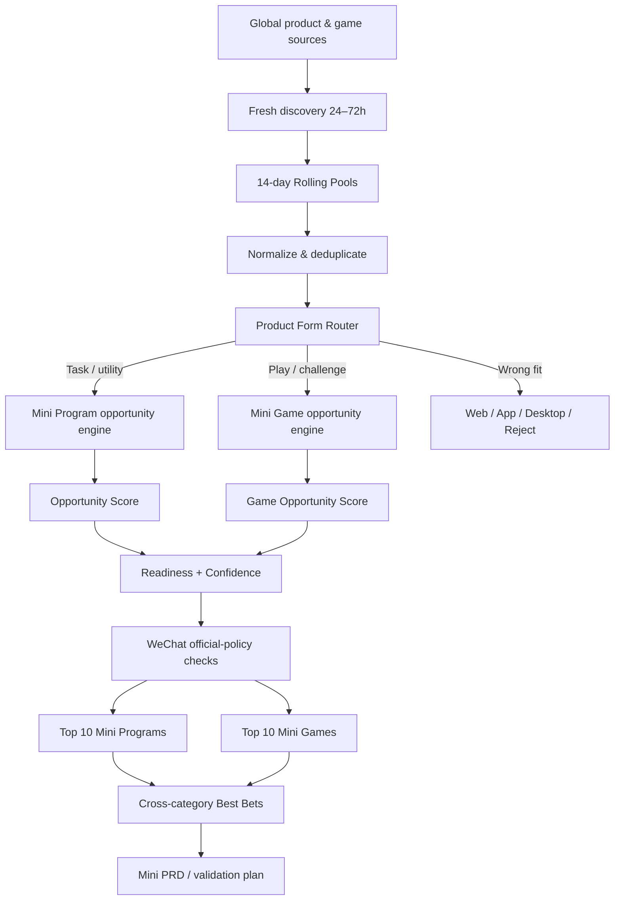

# Architecture

Version: 1.3.1

The repository is an **instruction Skill**, not a hosted SaaS backend. Network activity is performed by the host Agent/tooling according to the rules in `SKILL.md`.

## High-level flow



## Core layers

### 1. Discovery layer

Defined by `references/source_registry.md`.

Separates product/utility sources from game/mechanic sources.

### 2. Rolling-memory layer

Defined by `references/rolling_candidate_pool.md`.

Freshness matters, but yesterday's strong opportunity is not removed just because today has more launches.

### 3. Product Form Router

Defined by `references/platform_router.md`.

This is a major guardrail: not every global product should become a WeChat Mini Program.

### 4. Opportunity engines

Defined by `references/scoring_model.md`.

Mini Program and Mini Game scoring are intentionally different.

### 5. Evidence layer

Defined by `references/evidence_rules.md`.

Observed / Proxy / Estimate / Unknown prevents launch metrics from being mistaken for revenue or market truth.

### 6. WeChat readiness layer

Defined by:

- `references/china_feasibility_gate.md`
- `references/wechat_official_constraints.md`

Opportunity quality and implementation readiness are separate concepts.

### 7. Requirement-conversion layer

Defined by `references/output_schema.md` and `assets/report_template.md`.

Outputs separate opportunity boards and PRD-ready concepts.

## Repository layout

```text
SKILL.md                       # main runtime contract
UNIVERSAL_SINGLE_FILE.md       # single-file fallback
references/                    # scoring, routing, evidence, policy rules
assets/                        # report/config templates
docs/                          # human-facing documentation
evals/                         # regression/evaluation cases
scripts/                       # local repository validation only
test-prompts.json              # portable prompt-level smoke tests
```

## Design principle

The Skill separates five questions that are often incorrectly merged:

1. Is this new?
2. Is this hot?
3. Is this worth building?
4. Is this easy to validate/build?
5. Is this actually launchable on WeChat?

A good opportunity can score differently on every axis.
