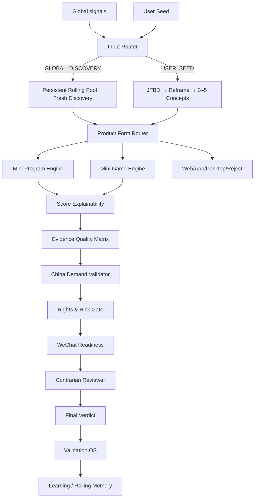

# Architecture

Version: 1.5.0

The repository is an instruction Skill plus a small zero-dependency state utility.

## High-level flow

## Layers

### Input / Productization
- User Seed Mode
- JTBD Extraction
- Product Reframe
- Multi-Concept Generation

### Discovery / Memory
- Source Registry
- `data/rolling_pool.json`
- `scripts/rolling-pool.mjs`

### Decision
- Product Form Router
- Mini Program / Mini Game scoring
- Score Explainability

### Trust
- Evidence Quality Matrix
- China Demand Validator
- Rights & Risk Gate
- WeChat Readiness
- Contrarian Reviewer

### Learning
- Validation OS
- score history
- Champion movement

## Persistent-state boundary

The public Rolling Pool may contain only public market signals.

It must never contain:
- user-private seeds;
- personal data;
- private files;
- tokens/cookies/credentials.

## Design principle

Keep these questions separate:

1. What is the real JTBD?
2. Is the proposed product definition correct?
3. What alternative concepts exist?
4. Which product form fits?
5. How strong is the opportunity?
6. Why does each score component deserve that score?
7. How good is the evidence?
8. Does China demand exist?
9. Do we have the right to use the content/data?
10. What would a skeptic say?
11. What experiment could kill the idea quickly?
12. What did we learn over time?
