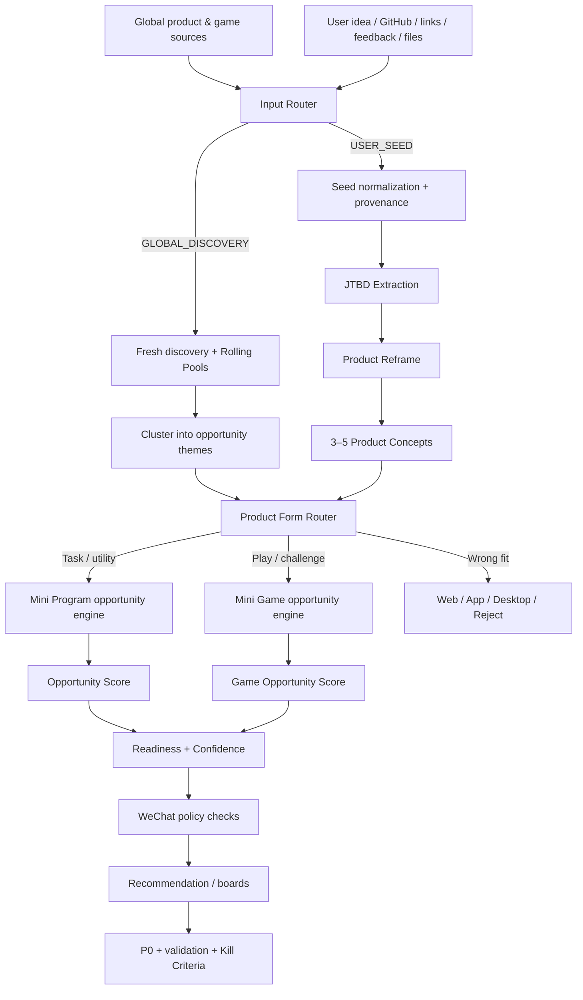

# Architecture

Version: 1.4.0

The repository is an **instruction Skill**, not a hosted SaaS backend. Network activity is performed by the host Agent/tooling according to the rules in `SKILL.md`.

## High-level flow

## Core layers

### 1. Input layer
Defined by `references/user_seed_mode.md`.

Two entry paths:
- GLOBAL_DISCOVERY
- USER_SEED

### 2. Discovery layer
Defined by `references/source_registry.md`.

### 3. Productization layer
Defined by:
- `references/jtbd_extraction.md`
- `references/product_reframe.md`
- `references/multi_concept_generation.md`

This layer prevents premature solution lock-in.

### 4. Rolling-memory layer
Defined by `references/rolling_candidate_pool.md`.

Used primarily for GLOBAL_DISCOVERY.

### 5. Product Form Router
Defined by `references/platform_router.md`.

The router receives opportunity themes or productized concepts, not blindly the raw user wording.

### 6. Opportunity engines
Defined by `references/scoring_model.md`.

v1.4.0 keeps the v1.3 Mini Program and Mini Game weights unchanged.

### 7. Evidence layer
Defined by `references/evidence_rules.md`.

Observed / Proxy / Estimate / Unknown remain mandatory.

### 8. WeChat readiness layer
Defined by:
- `references/china_feasibility_gate.md`
- `references/wechat_official_constraints.md`

### 9. Requirement-conversion layer
Defined by `references/output_schema.md` and `assets/report_template.md`.

## Design principle

The Skill separates questions that are often incorrectly merged:

1. What problem/job is actually present?
2. Is the user's original product definition correct?
3. What other product concepts can solve the same job?
4. What product form fits?
5. Is this worth building?
6. Is it hot/new?
7. Is it easy to validate?
8. Is it launchable on WeChat?

A strong answer is allowed to reject the user's original solution while preserving the underlying opportunity.
